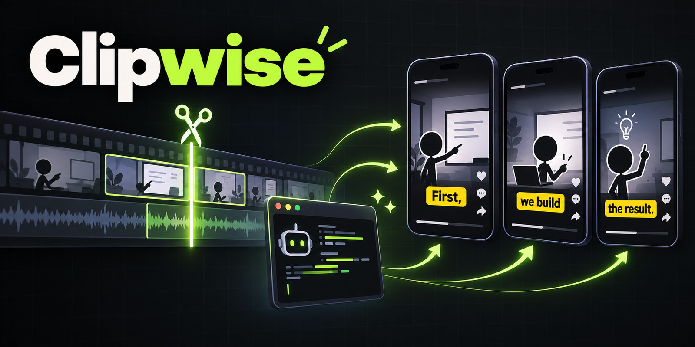
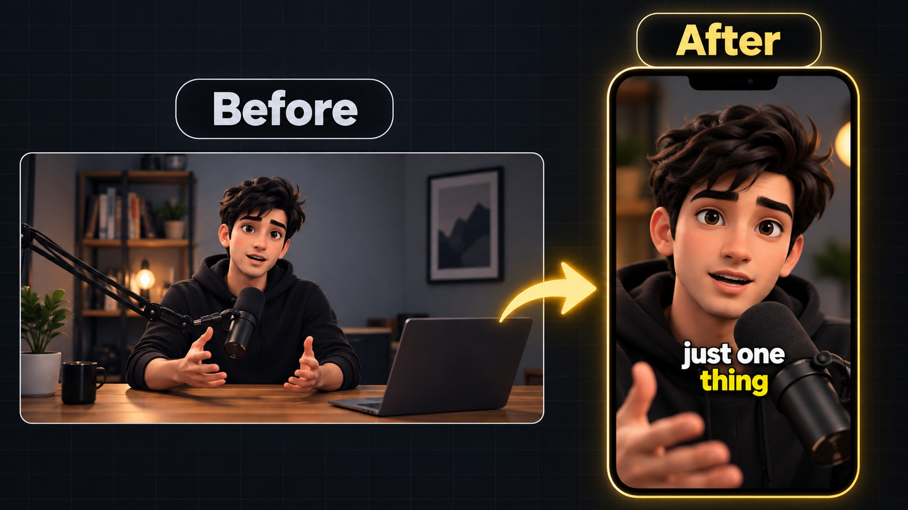
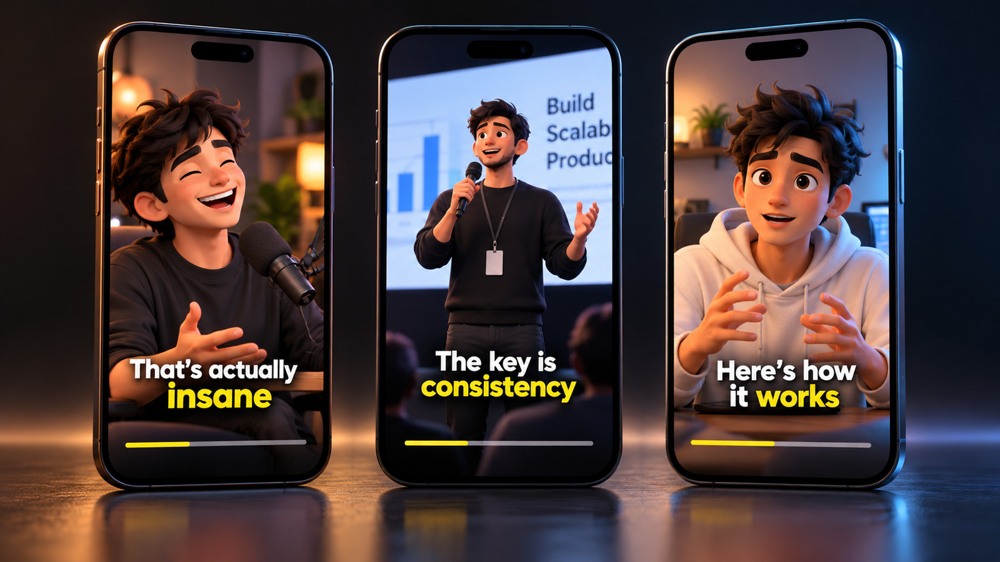
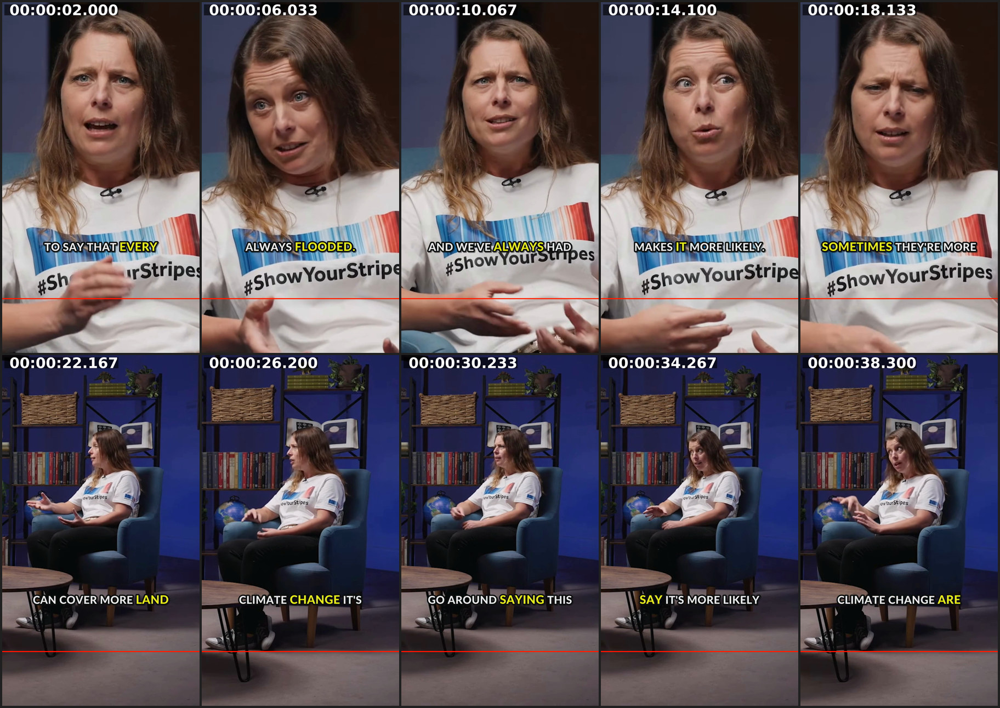
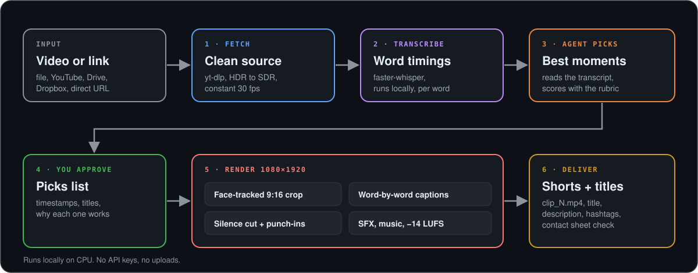

<p align="center">
  
</p>

<h3 align="center">Give your coding agent a video link. Get viral Shorts back.</h3>

<p align="center">
  <a href="LICENSE"></a>
  
  
  
</p>

clipwise is an agent skill: one folder with a `SKILL.md`, a scoring rubric and a few Python
scripts. Install it into your coding agent, paste a YouTube link or a file path, and the agent
transcribes the video, picks the moments worth posting, checks them with you, and renders
finished 9:16 clips with face-tracked framing, word-by-word captions, sound effects and
broadcast-level loudness. Everything runs on your machine. No API keys, no uploads, no
per-minute fees.

## Demo

<p align="center"></p>

<p align="center"></p>

A real contact sheet from the test render (40.6 s clip from a CC BY interview, default
quality, measured on a 2-core CPU). Ten evenly spaced frames; the red line marks where the
platform UI starts.

<p align="center"></p>

## What it does

- **Takes any source**: local file, YouTube and other yt-dlp sites, public Google Drive or
  Dropbox links, direct `.mp4/.mov/.webm` URLs. iPhone HDR / variable-frame-rate footage is
  tone-mapped and conformed automatically.
- **Transcribes locally** with faster-whisper (large-v3-turbo by default), word-level timings,
  on CPU or CUDA.
- **Your agent picks the moments**, not a keyword heuristic: it reads the transcript and
  scores candidates with a rubric (hook, emotion, curiosity, story, value, relatability), then
  shows you the list before anything is rendered.
- **Hook first**: a strong line from mid-clip can be moved to the first 2-3 seconds.
- **Dead air removed**: pauses over 0.35 s are cut with a threshold tuned to each clip.
- **Face-tracked 9:16 crop** from 16:9 (OpenCV YuNet), with a sticky tracker and a smooth
  camera that only snaps on cuts. Blurred-background layout for wide multi-person shots.
- **Punch-in zooms** every 2-4 s, aligned to cuts and sentence ends.
- **Word-by-word captions** (active word highlighted), placed below the chin and above the
  bottom 300 px that Shorts/Reels/TikTok cover with buttons.
- **Sound**: voice cleanup, sound effects synthesised at render time (whoosh, thud, pop), an
  optional music bed of your own that ducks under the voice, two-pass loudness to -14 LUFS.
- **Ready to post**: title, description, pinned-comment idea and hashtags per clip, plus a
  contact sheet the agent inspects before handing the clip over.

## How it works

<p align="center"></p>

1. `fetch.py` downloads and conforms the source to a clean H.264/AAC file.
2. `transcribe.py` writes `transcript.txt` with timestamps and word indices.
3. The agent reads it with `references/viral-rubric.md` and writes `picks.json`.
4. You approve (or edit) the list.
5. `render.py` cuts, tracks, captions, mixes and encodes each pick, then `look.py` makes a
   contact sheet the agent checks with its vision tool.

## Install

**1. Copy the `clipwise/` folder into your agent's skills directory.**

```bash
git clone https://github.com/RajkumarDake/clipwise.git
```

| Agent | Where the folder goes |
| --- | --- |
| Claude Code | `~/.claude/skills/clipwise` (all projects) or `.claude/skills/clipwise` (one project) |
| Codex CLI / IDE | `~/.agents/skills/clipwise` (or the older `~/.codex/skills/clipwise`, still scanned); per repo: `.agents/skills/clipwise` |
| Hermes Agent | `~/.hermes/skills/clipwise` |
| OpenClaw | `openclaw skills install ./clipwise` (workspace) or add `--global`; or copy into `<workspace>/skills/clipwise` |
| Cursor / Windsurf / Cline | anywhere in the repo (e.g. `tools/clipwise`), then add a project rule (`.cursor/rules`, `.windsurfrules`, `.clinerules`): "To turn a video into Shorts, read and follow `tools/clipwise/SKILL.md`" |
| Any other agent | put the folder anywhere and tell it: "Read `path/to/clipwise/SKILL.md` and follow it" |

Example for Claude Code:

```bash
mkdir -p ~/.claude/skills
cp -r clipwise/clipwise ~/.claude/skills/clipwise
```

If your Codex setup does not pick the skill up, add one line to `AGENTS.md`:
`To make Shorts from a video, follow ~/.agents/skills/clipwise/SKILL.md.`

**2. Run the setup once.** Read [`clipwise/setup.sh`](clipwise/setup.sh) first; it only
writes to `~/.clipwise` (override with `CLIPWISE_HOME`).

```bash
bash ~/.claude/skills/clipwise/setup.sh    # path of wherever you copied the folder
```

It checks Python 3.10+ and ffmpeg (with libass) and prints the install command if one is
missing, creates a venv, installs `requirements.txt`, downloads the YuNet face model and the
Lato Black caption font (both pinned and sha256-verified), and pre-downloads the whisper
model (about 1.6 GB; skip with `--no-model`). Re-running it is safe.
Verify with `python3 <skill>/scripts/run.py check`.

## Usage

Talk to your agent:

```text
Make 5 Shorts from https://www.youtube.com/watch?v=XXXXXXXXXXX
```

```text
Cut Reels from ~/Videos/podcast_ep12.mp4, only minutes 10-25, captions in Spanish.
```

```text
Make 2 Shorts from interview.mov with ~/Music/bed.mp3 as a quiet music bed, green highlight.
```

The agent shows you the picks (timestamps, hook, title, why) and waits for your OK before
rendering. More prompts in [`examples/prompts.md`](examples/prompts.md).

**How many Shorts?** If you name a number, you get exactly that many, unless the video does
not have that many strong moments; then the agent says so and proposes the honest number.
Without a number it scales with length: under 5 min -> 1-2, 5-15 min -> 3-5, 15-45 min -> 5-8,
45 min+ podcast -> 8-15. Only moments that pass the rubric checklist are kept; weak clips are
never added to reach a count.

You can also run the scripts yourself:

```bash
python3 clipwise/scripts/run.py prep "https://..." --job talk
# write ~/clipwise-work/talk/picks.json (see examples/picks.json)
python3 clipwise/scripts/run.py render --job talk          # add --fast for a preview
```

## Output

```text
~/clipwise-work/talk/
├── source.mp4            conformed source (delete with: run.py clean --job talk)
├── transcript.txt        what the agent reads
├── transcript.json       segments + word timings
├── words.tsv             word index, start, end, probability
├── picks.json            the approved moments
└── out/
    ├── clip_1.mp4        1080x1920, 30 fps, H.264 + AAC, -14 LUFS
    ├── clip_1.txt        title, description, pinned comment, hashtags
    ├── clip_1.json       probe numbers, layout, face coverage, SFX cues, timings
    ├── clip_1_cutmap.json
    └── clip_1_sheet.png  contact sheet
```

`clip_1.txt` from the test render:

```text
TITLE: Is every flood caused by climate change?

DESCRIPTION: A flood scientist on what climate change does and does not cause.

PINNED COMMENT: Did you think every flood was climate change?

HASHTAGS: #shorts #climate #science #floods

WHY: Opens on a claim people don't expect from a climate scientist, resolves it with 'more likely, not always'.
SOURCE: 1:05.50-1:50.35, hook 1:14.85-1:20.10
```

## Requirements

- Python 3.10+ and ffmpeg built with libass (Ubuntu/Debian `apt install ffmpeg`, macOS
  `brew install ffmpeg`, Windows via WSL2).
- About 2.5 GB disk for the venv and the whisper model, plus room for your videos.
- 4 GB+ RAM. A GPU is optional.
- A coding agent that can run shell commands and look at images.

## Performance

Measured on a 2-core cloud VM, CPU only, while writing this README:

| step | input | time |
| --- | --- | --- |
| fetch (download) | 85 MB 1080p WebM from Wikimedia | about 5 min (server-limited) |
| fetch (conform) | 3 min 1080p VP9 window to H.264 | about 2.5 min |
| fetch (conform) | 20 s 10-bit HDR iPhone clip, tone-map + CFR | 45 s |
| transcribe | 3 min English, large-v3-turbo int8 | 110 s (0.61x realtime) + 19 s model load |
| render, default quality | 40.6 s clip, face-tracked crop | 85 s |
| render, `--fast` | 26.4 s clip, crop | 32 s |
| render, `--fast --layout pad` | 17.1 s clip | 30 s |

Probe of the default-quality clip: video 40.63 s / audio 40.57 s, 1080x1920, 30 fps,
-14.0 LUFS integrated, -1.5 dBTP. On a modern laptop expect roughly 2-4x faster; with CUDA,
transcription is a few seconds per minute.

## Limitations

- The tracker follows the largest face, not the active speaker. In a wide two-person shot
  it holds on one person (no flicker), so the other speaker may be off-screen; use
  `--layout pad` there.
- Whisper returns English for many non-Latin-script languages and code-mixed speech instead
  of transcribing them. The agent then has to write the captions in the speaker's language
  itself (supported via `caption_overrides`), and you should check those lines.
- YouTube sometimes blocks downloads from servers and some home IPs ("confirm you're not a
  bot"). Pass `--cookies cookies.txt` or give the agent the file.
- 720p sources look soft after the 9:16 crop (2.7x upscale).
- Picking quality depends on your agent's model; the rubric keeps it honest but it is still
  judgement.
- Tested on Linux. macOS should work (Homebrew ffmpeg); Windows only through WSL2.

## FAQ

**Does it need a GPU?** No. Everything was developed and measured on a 2-core CPU. If CUDA
is available, transcription uses it automatically.

**Which languages?** Any language whisper detects is transcribed with word timings. Captions
are written in the speaker's language; for languages whisper translates instead (common with
Indic and other non-Latin scripts, and mixed-language speech), the agent writes the caption
lines itself and shows them to you before rendering.

**YouTube is blocked. What now?** Export `cookies.txt` from a browser where you are logged
in and pass `--cookies cookies.txt`, or download the video yourself and give the agent the
file path.

**How many Shorts will I get?** The number you ask for, or a count based on video length
(1-2 under 5 minutes up to 8-15 for a long podcast). The agent will tell you if fewer
moments are strong enough.

**What does it cost?** Nothing beyond your agent subscription. All models run locally; no
paid APIs.

**Can I use my own sounds or music?** Yes: `--sfx-dir` with your own `whoosh_fast`,
`whoosh_soft`, `thud_low`, `pop`, `tick` files, and `--music bed.mp3` for a ducked music bed.
Use audio you have the rights to. No audio files ship with clipwise; the default SFX are
generated by `scripts/sfx.py`.

## Credits

- [faster-whisper](https://github.com/SYSTRAN/faster-whisper) (MIT) and the
  [large-v3-turbo CTranslate2 conversion](https://huggingface.co/mobiuslabsgmbh/faster-whisper-large-v3-turbo) (MIT) of OpenAI Whisper.
- [OpenCV](https://opencv.org) and the [YuNet face detector](https://github.com/opencv/opencv_zoo/tree/main/models/face_detection_yunet) (MIT).
- [FFmpeg](https://ffmpeg.org) (LGPL/GPL) with libass.
- [yt-dlp](https://github.com/yt-dlp/yt-dlp) (Unlicense).
- [Lato](https://fonts.google.com/specimen/Lato) by Łukasz Dziedzic (SIL Open Font License), downloaded by setup.sh.
- Test footage in the demo contact sheet and `examples/picks.json`:
  "[Interview on extreme weather with physical geographer Hannah Cloke](https://commons.wikimedia.org/wiki/File:Interview_on_extreme_weather_with_physical_geographer_Hannah_Cloke_%E2%80%93_The_Royal_Society.webm)"
  by The Royal Society, [CC BY 3.0](https://creativecommons.org/licenses/by/3.0/), via Wikimedia Commons. Frames were cropped and captioned.

## License

[MIT](LICENSE) © 2026 Rajkumar Dake
